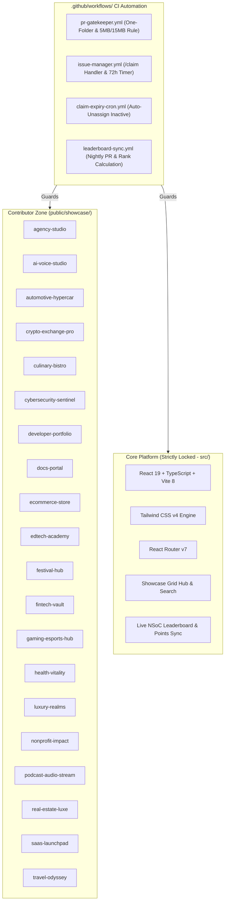

# 🚀 CAREERFORGE Deep Project Analysis & 42 Multi-Level Contributor Issues Catalog

**Repository:** `Pratyush-Panda-2006/CAREERFORGE`  
**Initiative:** Nexus Spring of Code 2026 (NSoC '26)  
**Branch:** `main` (Fast-forwarded to latest commit `a08c851`)  
**Catalog Size:** 42 Comprehensive Contributor Issues  

---

## 📑 Table of Contents
1. [Upstream Synchronization Summary](#1-upstream-synchronization-summary)
2. [Deep Architectural & Codebase Analysis](#2-deep-architectural--codebase-analysis)
3. [Current Showcase Inventory & Metrics](#3-current-showcase-inventory--metrics)
4. [Contributor Level System & Scored Rubric](#4-contributor-level-system--scored-rubric)
5. [Complete Catalog: 42 Contributor Issues](#5-complete-catalog-42-contributor-issues)
   - [Level 1: Beginner / Quick-Wins (20 Issues — 3 Points)](#level-1-beginner--quick-wins-20-issues--3-points)
   - [Level 2: Intermediate / UI & Components (14 Issues — 5 Points)](#level-2-intermediate--ui--components-14-issues--5-points)
   - [Level 3: Advanced / Core Logic & Testing Engines (8 Issues — 10 Points)](#level-3-advanced--core-logic--testing-engines-8-issues--10-points)
6. [Automated GitHub Batch Issue Creation Script](#6-automated-github-batch-issue-creation-script)

---

## 1. Upstream Synchronization Summary

All latest upstream changes have been fetched and cleanly merged into the local working tree:

- **Git Operation:** `git pull origin main`
- **Fast-Forward Transition:** `1f31dfa` ➔ `a08c851`
- **Volume:** **76 files changed**, **27,122 insertions(+)**, **586 deletions(-)**
- **Recent Merges:**
  - `PR #261`: feat(agency-studio): Add interactive client awards & recognitions showcase ticker with animated counter
  - `PR #265`: feat(real-estate): Add accessible property photo gallery
  - `PR #256`: feat(crypto): Add order book depth visualizer
  - `PR #257`: feat(developer-portfolio): Terminal command pills
  - `PR #258`: feat(ecommerce): Empty cart state view
  - `PR #259`: feat(hypercar): Spec accent styling
  - `PR #260`: fix(crypto): Align mobile order book columns
- **Leaderboard Status:** `115 merged PRs` tracked across 40+ active open-source contributors.

---

## 2. Deep Architectural & Codebase Analysis

The CAREERFORGE repository employs a **dual-layer isolated architecture** designed specifically to scale multi-contributor open-source hackathons without merge conflicts or regressions:



### Architectural Pillars:
1. **The Protected Core (`src/`)**:
   - Contains React 19, TypeScript, Tailwind 4, Lucide React, and React Router DOM v7.
   - Houses the central landing page, certificates engine, showcase discovery gallery, and real-time leaderboard.
   - **Enforced Rule:** Strictly locked via `pr-gatekeeper.yml`. PRs modifying files in `src/` are rejected automatically.
2. **The Contributor Showcase Sandboxes (`public/showcase/`)**:
   - 20 independent static website templates built with vanilla HTML5, modern CSS3, and ES6+ JavaScript.
   - Every contributor PR must touch **exactly one showcase directory**, preventing merge conflicts between contributors working concurrently.
3. **Automated Governance & Claim Lifecycle**:
   - Contributors claim tasks by typing `/claim` on any open issue.
   - The bot sets a strict 72-hour timer. Expired claims are reclaimed by `claim-expiry-cron.yml`.
   - Asset sizes are strictly capped (< 5MB per asset, < 15MB total PR footprint).
4. **Unit Test Infrastructure**:
   - Showcases utilize Node's native test runner (`node:test` and `node:assert/strict`) with zero third-party testing dependencies.
   - 11 showcases currently have automated tests, while 9 showcases lack automated coverage.

---

## 3. Current Showcase Inventory & Metrics

| # | Showcase Directory | HTML (KB) | JS (KB) | CSS (KB) | Automated Tests | Primary Tech Focus |
|---|--------------------|-----------|---------|----------|-----------------|--------------------|
| 1 | `agency-studio` | 32.2 | 54.3 | 51.6 | `awards.test.mjs` | Design agency portfolio & ticker |
| 2 | `ai-voice-studio` | 22.1 | 37.5 | 29.0 | `mobile-layout.test.cjs` | TTS audio synthesizer & studio |
| 3 | `automotive-hypercar` | 22.4 | 66.7 | 38.6 | ⚠️ None | 0-60 simulator & wind tunnel |
| 4 | `crypto-exchange-pro` | 13.3 | 33.8 | 18.9 | `depth.test.cjs` | DEX perpetual order book |
| 5 | `culinary-bistro` | 29.4 | 44.6 | 49.6 | `tasting.test.mjs` | Multi-course fine dining menu |
| 6 | `cybersecurity-sentinel` | 16.8 | 51.0 | 31.4 | ⚠️ None | Threat map & port scanner |
| 7 | `developer-portfolio` | 19.9 | 24.5 | 18.9 | ⚠️ None | Interactive retro CLI terminal |
| 8 | `docs-portal` | 15.2 | 12.8 | 17.1 | `script.test.js` | API documentation & sandbox |
| 9 | `ecommerce-store` | 25.0 | 56.2 | 44.7 | ⚠️ None | Tech gear catalog & cart drawer |
| 10 | `edtech-academy` | 33.4 | 66.2 | 54.8 | `flashcards.test.mjs` | Spaced-repetition flashcards |
| 11 | `festival-hub` | 24.4 | 24.0 | 32.0 | ⚠️ None | EDM festival lineup & planner |
| 12 | `fintech-vault` | 30.7 | 33.1 | 44.3 | `ledger.test.mjs` | Compound interest & vault |
| 13 | `gaming-esports-hub` | 32.8 | 60.7 | 69.6 | `bracket.test.mjs` | Tournament bracket visualizer |
| 14 | `health-vitality` | 45.3 | 37.6 | 48.1 | ⚠️ None | Longevity dashboard & nutrition |
| 15 | `luxury-realms` | 22.5 | 84.8 | 48.7 | ⚠️ None | Jet charter & island concierge |
| 16 | `nonprofit-impact` | 22.2 | 52.7 | 35.1 | `carbon.test.mjs` | Reforestation tracker & donor wall |
| 17 | `podcast-audio-stream` | 7.7 | 25.8 | 25.0 | `player-logic.test.mjs` | Audio streaming & equalizer |
| 18 | `real-estate-luxe` | 16.6 | 25.3 | 34.5 | `estates.test.mjs` | Luxury estates & mortgage calc |
| 19 | `saas-launchpad` | 41.4 | 24.9 | 42.4 | ⚠️ None | AI telemetry SaaS landing |
| 20 | `travel-odyssey` | 25.7 | 43.5 | 32.6 | ⚠️ None | Expedition itinerary & packing |

---

## 4. Contributor Level System & Scored Rubric

Under the Nexus Spring of Code 2026 rubric, tasks are weighted based on complexity:

| Tier | Label | Points | Description & Target Contributor Persona |
| :--- | :--- | :---: | :--- |
| **Level 1** | `level1` | **3 pts** | **Beginner / Good First Issue**: Badges, status pills, tooltips, accessible form elements, semantic HTML improvements, lightweight UI accents. |
| **Level 2** | `level2` | **5 pts** | **Intermediate**: Modals, filter tabs, interactive calculators, theme toggles, animated cards, drawer panels, responsive overhauls. |
| **Level 3** | `level3` | **10 pts** | **Advanced**: Algorithmic simulators, HTML5 canvas graphics, test suites using `node:test`, physics simulations, audio synthesis engines. |

---

## 5. Complete Catalog: 42 Contributor Issues

### Level 1: Beginner / Quick-Wins (20 Issues — 3 Points)

#### 1. `[agency-studio]` Add interactive project delivery timeline badge and estimated turnaround indicator
- **Labels:** `nsoc26`, `level1`, `good first issue` | **Points:** 3
- **Directory:** `public/showcase/agency-studio/`
- **Summary:** Add an interactive turnaround estimate badge (e.g. `⚡ 2-3 Weeks Rapid Sprint`) on service cards with hover tooltips detailing agency sprint milestones (Discovery ➔ Design ➔ Launch).
- **Files Modified:** `index.html`, `styles.css`, `script.js`

#### 2. `[ai-voice-studio]` Add character count and estimated audio duration badge to voice script input
- **Labels:** `nsoc26`, `level1`, `good first issue` | **Points:** 3
- **Directory:** `public/showcase/ai-voice-studio/`
- **Summary:** Add a dynamic character counter and spoken audio duration calculator beneath the script prompt textarea (assuming average human speaking pace of ~150 words per minute).
- **Files Modified:** `index.html`, `styles.css`, `script.js`

#### 3. `[automotive-hypercar]` Add battery charging speed indicator card with AC vs DC Fast Charger toggle
- **Labels:** `nsoc26`, `level1`, `good first issue` | **Points:** 3
- **Directory:** `public/showcase/automotive-hypercar/`
- **Summary:** Display an interactive charging comparison card contrasting Level 2 AC (11kW) vs 800V DC (350kW) charge replenishment times with animated battery level bars.
- **Files Modified:** `index.html`, `styles.css`, `script.js`

#### 4. `[crypto-exchange-pro]` Add trading fee tier discount badge and 30-day VIP level progress pill
- **Labels:** `nsoc26`, `level1`, `good first issue` | **Points:** 3
- **Directory:** `public/showcase/crypto-exchange-pro/`
- **Summary:** Add a prominent VIP Fee Tier chip in the exchange top bar displaying current maker/taker fee rates and required 30-day trading volume to reach the next tier.
- **Files Modified:** `index.html`, `styles.css`, `script.js`

#### 5. `[culinary-bistro]` Add table seating area preference selector (Main Dining, Patio, Chef Counter) to reservation form
- **Labels:** `nsoc26`, `level1`, `good first issue` | **Points:** 3
- **Directory:** `public/showcase/culinary-bistro/`
- **Summary:** Add interactive seating preference selector radio cards (Main Dining Salon, Heated Garden Patio, Chef's Tasting Counter) with contextual badges and outdoor weather advisory notes.
- **Files Modified:** `index.html`, `styles.css`, `script.js`

#### 6. `[cybersecurity-sentinel]` Add interactive system security health score badge with compliance status
- **Labels:** `nsoc26`, `level1`, `good first issue` | **Points:** 3
- **Directory:** `public/showcase/cybersecurity-sentinel/`
- **Summary:** Place a security posture score badge (e.g. `🛡️ 98/100 SOC-2 Compliant`) in the platform header with a popover showing active defense layers.
- **Files Modified:** `index.html`, `styles.css`, `script.js`

#### 7. `[developer-portfolio]` Add interactive availability status badge (Available for Q2 Contracts) with calendar preview tooltip
- **Labels:** `nsoc26`, `level1`, `good first issue` | **Points:** 3
- **Directory:** `public/showcase/developer-portfolio/`
- **Summary:** Add a live availability pill with pulsing green indicator dot in the developer hero, showing engagement types (Remote Frontend, Open Source Architecture).
- **Files Modified:** `index.html`, `styles.css`, `script.js`

#### 8. `[docs-portal]` Add HTTP status codes reference drawer with quick error explanation tooltips
- **Labels:** `nsoc26`, `level1`, `good first issue` | **Points:** 3
- **Directory:** `public/showcase/docs-portal/`
- **Summary:** Add an accessible HTTP status reference accordion (200, 201, 400, 401, 429, 500) with color-coded status badges and quick troubleshooting tips.
- **Files Modified:** `index.html`, `styles.css`, `script.js`

#### 9. `[ecommerce-store]` Add interactive free shipping progress bar showing amount remaining to unlock free delivery
- **Labels:** `nsoc26`, `level1`, `good first issue` | **Points:** 3
- **Directory:** `public/showcase/ecommerce-store/`
- **Summary:** Embed an animated progress bar inside the cart drawer that calculates the remaining balance to reach the $150 free shipping milestone.
- **Files Modified:** `index.html`, `styles.css`, `script.js`

#### 10. `[edtech-academy]` Add course prerequisite checklist with interactive completion checkboxes
- **Labels:** `nsoc26`, `level1`, `good first issue` | **Points:** 3
- **Directory:** `public/showcase/edtech-academy/`
- **Summary:** Add a prerequisite knowledge checklist card on course overview pages, highlighting ready-to-enroll status once all checkboxes are checked.
- **Files Modified:** `index.html`, `styles.css`, `script.js`

#### 11. `[festival-hub]` Add interactive festival FAQ accordion with category filter tabs
- **Labels:** `nsoc26`, `level1`, `good first issue` | **Points:** 3
- **Directory:** `public/showcase/festival-hub/`
- **Summary:** Implement a categorized FAQ accordion for festival attendees (Ticketing, Camping, Prohibited Items, Accessibility) with smooth CSS expansion.
- **Files Modified:** `index.html`, `styles.css`, `script.js`

#### 12. `[fintech-vault]` Add virtual card freeze/unfreeze security toggle button with animated card lock status
- **Labels:** `nsoc26`, `level1`, `good first issue` | **Points:** 3
- **Directory:** `public/showcase/fintech-vault/`
- **Summary:** Add an interactive freeze toggle on the virtual debit card widget, applying frosted blur, grayscale styling, and a lock status icon.
- **Files Modified:** `index.html`, `styles.css`, `script.js`

#### 13. `[gaming-esports-hub]` Add match countdown timer badge with 'Add to Calendar' ICS file export
- **Labels:** `nsoc26`, `level1`, `good first issue` | **Points:** 3
- **Directory:** `public/showcase/gaming-esports-hub/`
- **Summary:** Add an upcoming tournament match countdown clock badge with a one-click button downloading an `.ics` calendar invitation file.
- **Files Modified:** `index.html`, `styles.css`, `script.js`

#### 14. `[health-vitality]` Add daily hydration reminder alarm toggle with audio chime notification
- **Labels:** `nsoc26`, `level1`, `good first issue` | **Points:** 3
- **Directory:** `public/showcase/health-vitality/`
- **Summary:** Add a reminder bell icon toggle and interval selector dropdown (30m, 60m, 90m) with a synthesized Web Audio API chime sound preview.
- **Files Modified:** `index.html`, `styles.css`, `script.js`

#### 15. `[luxury-realms]` Add destination local time and weather forecast pill to private jet destination cards
- **Labels:** `nsoc26`, `level1`, `good first issue` | **Points:** 3
- **Directory:** `public/showcase/luxury-realms/`
- **Summary:** Render an interactive destination metadata pill on flight cards displaying real-time local time (UTC offset) and weather conditions.
- **Files Modified:** `index.html`, `styles.css`, `script.js`

#### 16. `[nonprofit-impact]` Add live impact metric badge counter (Acres Protected / Communities Supported) with animated count-up
- **Labels:** `nsoc26`, `level1`, `good first issue` | **Points:** 3
- **Directory:** `public/showcase/nonprofit-impact/`
- **Summary:** Add an impact statistics banner with smooth numerical easing animations displaying acres preserved, communities supported, and trees planted.
- **Files Modified:** `index.html`, `styles.css`, `script.js`

#### 17. `[podcast-audio-stream]` Add episode share modal with custom timestamp URL generator and one-click copy button
- **Labels:** `nsoc26`, `level1`, `good first issue` | **Points:** 3
- **Directory:** `public/showcase/podcast-audio-stream/`
- **Summary:** Create an episode sharing modal with optional 'Start at current timestamp' checkbox and one-click clipboard copy with toast feedback.
- **Files Modified:** `index.html`, `styles.css`, `script.js`

#### 18. `[real-estate-luxe]` Add private viewing scheduling modal with date-time picker and agent selector
- **Labels:** `nsoc26`, `level1`, `good first issue` | **Points:** 3
- **Directory:** `public/showcase/real-estate-luxe/`
- **Summary:** Add a 'Schedule Private Tour' modal dialog on property cards with date-time validation and concierge agent selection.
- **Files Modified:** `index.html`, `styles.css`, `script.js`

#### 19. `[saas-launchpad]` Add live system status indicator widget (99.99% Uptime) with operational status badge
- **Labels:** `nsoc26`, `level1`, `good first issue` | **Points:** 3
- **Directory:** `public/showcase/saas-launchpad/`
- **Summary:** Add a platform status indicator pill with a pulsing green dot in the footer/header linking to a service health breakdown drawer.
- **Files Modified:** `index.html`, `styles.css`, `script.js`

#### 20. `[travel-odyssey]` Add interactive visa and entry requirements checker card based on traveler nationality
- **Labels:** `nsoc26`, `level1`, `good first issue` | **Points:** 3
- **Directory:** `public/showcase/travel-odyssey/`
- **Summary:** Add an entry requirements advisory card where travelers select their passport issuing country to see visa and vaccination regulations.
- **Files Modified:** `index.html`, `styles.css`, `script.js`

---

### Level 2: Intermediate / UI & Components (14 Issues — 5 Points)

#### 21. `[ai-voice-studio]` Build audio export options modal with format (WAV/MP3) and bitrate selector
- **Labels:** `nsoc26`, `level2`, `enhancement` | **Points:** 5
- **Directory:** `public/showcase/ai-voice-studio/`
- **Summary:** Build an audio export configuration modal allowing users to choose format (WAV uncompressed, MP3 320kbps, OGG), set sample rate, input custom filenames, and download the audio blob.
- **Files Modified:** `index.html`, `styles.css`, `script.js`

#### 22. `[crypto-exchange-pro]` Build interactive leverage slider and liquidation price risk calculator
- **Labels:** `nsoc26`, `level2`, `enhancement` | **Points:** 5
- **Directory:** `public/showcase/crypto-exchange-pro/`
- **Summary:** Implement an interactive perpetual futures position calculator with leverage slider (1x up to 100x), computing estimated liquidation price and required initial margin.
- **Files Modified:** `index.html`, `styles.css`, `script.js`

#### 23. `[culinary-bistro]` Build digital gift card custom balance builder and preview card modal
- **Labels:** `nsoc26`, `level2`, `enhancement` | **Points:** 5
- **Directory:** `public/showcase/culinary-bistro/`
- **Summary:** Build an interactive dining gift certificate customizer with preset denominations, luxury themes, live certificate preview, and printable layout.
- **Files Modified:** `index.html`, `styles.css`, `script.js`

#### 24. `[developer-portfolio]` Build interactive technical article reader modal with reading progress indicator and copy-code buttons
- **Labels:** `nsoc26`, `level2`, `enhancement` | **Points:** 5
- **Directory:** `public/showcase/developer-portfolio/`
- **Summary:** Create an interactive technical article reader modal with scroll progress indicator bar, syntax-highlighted code blocks, and copy-code buttons.
- **Files Modified:** `index.html`, `styles.css`, `script.js`

#### 25. `[docs-portal]` Build interactive theme switcher (Dark, High-Contrast Obsidian, Light) with localStorage persistence
- **Labels:** `nsoc26`, `level2`, `enhancement` | **Points:** 5
- **Directory:** `public/showcase/docs-portal/`
- **Summary:** Implement a WCAG AA-compliant theme switcher for the documentation portal with three themes persisted across browser reloads via `localStorage`.
- **Files Modified:** `index.html`, `styles.css`, `script.js`

#### 26. `[festival-hub]` Build festival survival packing checklist with category progress counters and localStorage persistence
- **Labels:** `nsoc26`, `level2`, `enhancement` | **Points:** 5
- **Directory:** `public/showcase/festival-hub/`
- **Summary:** Build an interactive packing checklist with categorized checkboxes (Gear, Health, Camping) and live category completion progress bars.
- **Files Modified:** `index.html`, `styles.css`, `script.js`

#### 27. `[fintech-vault]` Build interactive subscription manager card with monthly spend breakdown and cancel reminder alerts
- **Labels:** `nsoc26`, `level2`, `enhancement` | **Points:** 5
- **Directory:** `public/showcase/fintech-vault/`
- **Summary:** Create a recurring subscription manager card with monthly spend breakdown, renewal dates, and renewal reminder badges.
- **Files Modified:** `index.html`, `styles.css`, `script.js`

#### 28. `[gaming-esports-hub]` Build tournament match prediction poll widget with live vote percentage bars
- **Labels:** `nsoc26`, `level2`, `enhancement` | **Points:** 5
- **Directory:** `public/showcase/gaming-esports-hub/`
- **Summary:** Implement an interactive match prediction widget where fans vote on match outcomes and view animated split percentage bars.
- **Files Modified:** `index.html`, `styles.css`, `script.js`

#### 29. `[luxury-realms]` Build bespoke onboard catering menu customizer with dietary preferences selector
- **Labels:** `nsoc26`, `level2`, `enhancement` | **Points:** 5
- **Directory:** `public/showcase/luxury-realms/`
- **Summary:** Build a luxury catering customizer where private jet passengers select bespoke dining tiers, specify dietary allergies, and update booking totals.
- **Files Modified:** `index.html`, `styles.css`, `script.js`

#### 30. `[nonprofit-impact]` Build interactive recurring donation impact calculator showing tangible monthly milestones
- **Labels:** `nsoc26`, `level2`, `enhancement` | **Points:** 5
- **Directory:** `public/showcase/nonprofit-impact/`
- **Summary:** Create an interactive monthly donation slider ($10 to $250/mo) calculating tangible annual outcomes (trees planted, reef acreage restored).
- **Files Modified:** `index.html`, `styles.css`, `script.js`

#### 31. `[podcast-audio-stream]` Build customizable sleep timer modal (15m, 30m, 45m, End of Episode) with countdown badge
- **Labels:** `nsoc26`, `level2`, `enhancement` | **Points:** 5
- **Directory:** `public/showcase/podcast-audio-stream/`
- **Summary:** Implement a sleep timer feature with volume fade-out prior to pause and a countdown timer pill in the player bar.
- **Files Modified:** `index.html`, `styles.css`, `script.js`

#### 32. `[real-estate-luxe]` Build monthly HOA and property tax cost breakdown calculator with dynamic summary pie chart
- **Labels:** `nsoc26`, `level2`, `enhancement` | **Points:** 5
- **Directory:** `public/showcase/real-estate-luxe/`
- **Summary:** Build an itemized monthly homeownership calculator estimating principal, interest, taxes, and HOA dues with a dynamic SVG donut chart.
- **Files Modified:** `index.html`, `styles.css`, `script.js`

#### 33. `[saas-launchpad]` Build interactive product feature tour modal with step-by-step navigation carousel
- **Labels:** `nsoc26`, `level2`, `enhancement` | **Points:** 5
- **Directory:** `public/showcase/saas-launchpad/`
- **Summary:** Build a multi-step interactive product walkthrough modal with slide transitions, step dots, and keyboard navigation.
- **Files Modified:** `index.html`, `styles.css`, `script.js`

#### 34. `[travel-odyssey]` Build printable expedition itinerary voucher generator with trip QR code and gear checklist
- **Labels:** `nsoc26`, `level2`, `enhancement` | **Points:** 5
- **Directory:** `public/showcase/travel-odyssey/`
- **Summary:** Build an expedition voucher generator compiling dates, emergency coordinates, and packing lists into a clean printable layout (`@media print`).
- **Files Modified:** `index.html`, `styles.css`, `script.js`

---

### Level 3: Advanced / Core Logic & Testing Engines (8 Issues — 10 Points)

#### 35. `[agency-studio]` Build interactive client deliverables ROI estimator and project scope configurator
- **Labels:** `nsoc26`, `level3`, `enhancement` | **Points:** 10
- **Directory:** `public/showcase/agency-studio/`
- **Summary:** Develop an interactive scope configurator where prospective clients select deliverables (Design System, 3D Assets, Full-Stack Architecture), calculating sprint duration, costs, and projected ROI lift with an 'Export Scope Brief' action.
- **Files Modified:** `index.html`, `styles.css`, `script.js`

#### 36. `[automotive-hypercar]` Implement interactive EV road trip range estimator with terrain & temperature simulation
- **Labels:** `nsoc26`, `level3`, `enhancement` | **Points:** 10
- **Directory:** `public/showcase/automotive-hypercar/`
- **Summary:** Build a physical EV hypercar range estimator adjusting for ambient temperature (-10°C to 45°C), driving modes, and elevation terrain gradients.
- **Files Modified:** `index.html`, `styles.css`, `script.js`

#### 37. `[cybersecurity-sentinel]` Implement interactive two-factor authentication (2FA) mock authenticator simulator with TOTP countdown timer
- **Labels:** `nsoc26`, `level3`, `enhancement` | **Points:** 10
- **Directory:** `public/showcase/cybersecurity-sentinel/`
- **Summary:** Build an authentic 2FA simulator featuring a 30-second circular SVG countdown ring, dynamic 6-digit TOTP code generation, and interactive verification input.
- **Files Modified:** `index.html`, `styles.css`, `script.js`

#### 38. `[ecommerce-store]` Implement interactive multi-item product comparison matrix drawer with feature highlighting
- **Labels:** `nsoc26`, `level3`, `enhancement` | **Points:** 10
- **Directory:** `public/showcase/ecommerce-store/`
- **Summary:** Build a slide-up comparison drawer comparing up to 3 products side-by-side with spec difference highlights and direct batch add-to-cart.
- **Files Modified:** `index.html`, `styles.css`, `script.js`

#### 39. `[edtech-academy]` Implement downloadable course completion certificate generator using HTML5 Canvas
- **Labels:** `nsoc26`, `level3`, `enhancement` | **Points:** 10
- **Directory:** `public/showcase/edtech-academy/`
- **Summary:** Build an interactive certificate generator rendering official student name, course specialization, verification hash, and gold foil seal onto HTML5 Canvas with high-resolution PNG download.
- **Files Modified:** `index.html`, `styles.css`, `script.js`

#### 40. `[health-vitality]` Implement interactive intermittent fasting tracker with circular timer and metabolic stage milestones
- **Labels:** `nsoc26`, `level3`, `enhancement` | **Points:** 10
- **Directory:** `public/showcase/health-vitality/`
- **Summary:** Build an intermittent fasting tracking engine supporting multiple protocols (16:8, 18:6, 20:4) with dual-ring SVG circular progress and real-time metabolic zone milestones (Fat Burning, Ketosis).
- **Files Modified:** `index.html`, `styles.css`, `script.js`

#### 41. `[automotive-hypercar]` Implement comprehensive physics & acceleration simulation test suite using Node.js test runner
- **Labels:** `nsoc26`, `level3`, `enhancement` | **Points:** 10
- **Directory:** `public/showcase/automotive-hypercar/`
- **Summary:** Create `public/showcase/automotive-hypercar/physics.test.mjs` using `node:test` and `node:assert/strict` validating acceleration formulas, aerodynamic drag equations, and battery range calculations under diverse conditions.
- **Files Modified:** `physics.test.mjs`, `script.js`

#### 42. `[ecommerce-store]` Implement comprehensive shopping cart and discount calculation test suite using Node.js test runner
- **Labels:** `nsoc26`, `level3`, `enhancement` | **Points:** 10
- **Directory:** `public/showcase/ecommerce-store/`
- **Summary:** Create `public/showcase/ecommerce-store/cart.test.mjs` using `node:test` and `node:assert/strict` testing item addition, quantity updates, subtotal precision, coupon codes, tax calculation, and free delivery thresholds.
- **Files Modified:** `cart.test.mjs`, `script.js`

---

## 6. Automated GitHub Batch Issue Creation Script

A ready-to-run automation script is stored at [`scripts/create-batch5-issues.mjs`](file:///e:/CAREERFORGE/scripts/create-batch5-issues.mjs).

### How to Execute:
1. **Local Dry-Run Validation (No Token Needed):**
   ```bash
   node scripts/create-batch5-issues.mjs --dry-run
   ```
2. **Publish Directly to GitHub:**
   ```bash
   # Option A: With active GitHub CLI session
   gh auth login
   node scripts/create-batch5-issues.mjs

   # Option B: With Personal Access Token (PAT)
   $env:GITHUB_TOKEN="ghp_yourPersonalAccessTokenHere"
   node scripts/create-batch5-issues.mjs
   ```
   *The script automatically paces requests by 1.2s to prevent GitHub secondary rate limits.*
